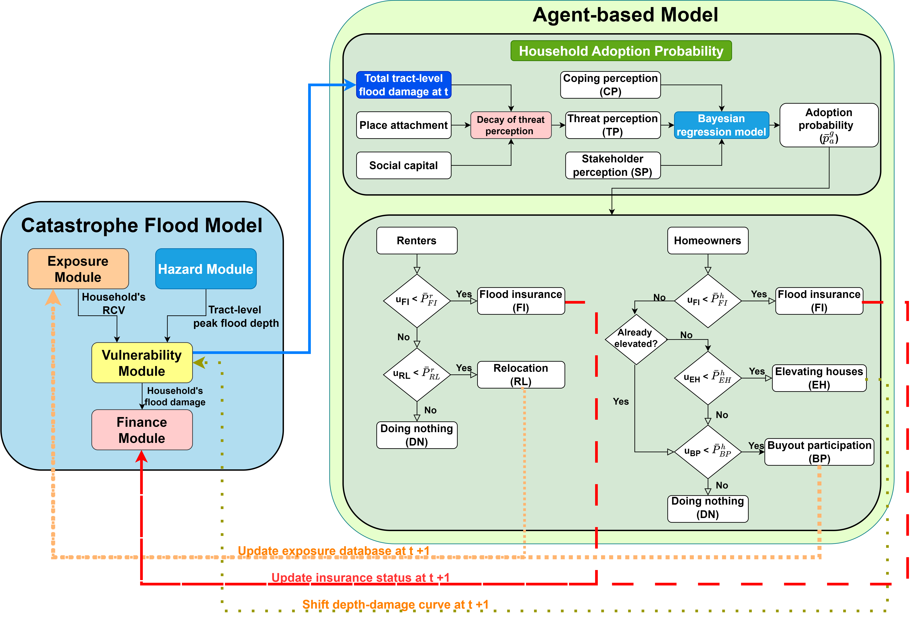

# FLOODABM

[](https://doi.org/10.5281/zenodo.20587985)

A coupled agent-based and catastrophe flood modeling framework (ABM-CAT) for simulating household flood adaptation in the Passaic River Basin, New Jersey (2011–2023).



*Two-way coupling between the agent-based model (ABM) and the catastrophe flood model (CAT). Flood depths drive damage and household threat perception (TP); adaptation decisions (FI / EH / BP / RL) modify exposure and vulnerability, which feed back into the next year's flood loss.*

## Overview

FLOODABM simulates how homeowners and renters make flood adaptation decisions across 27 census tracts over 13 years of historical flood events. The framework distinguishes four adaptive actions available by homeownership status:

| Action | Available to | Mechanism |
|--------|-------------|-----------|
| Flood Insurance (FI) | Both | Homeowners insure structure and contents, renters insure contents only (NFIP) |
| Elevation and Hardening (EH) | Homeowners | Raise first-floor height to reduce flood vulnerability |
| Buyout Program (BP) | Homeowners | Government acquisition that removes the structure from the floodplain |
| Relocation (RL) | Renters | Move to a different tract to reduce flood exposure |

Each action modifies exposure or vulnerability in the catastrophe flood model. Simulated flood damage feeds back into household threat perception (TP), which drives subsequent adaptation decisions. This two-way coupling is the central mechanism of the framework.

## Project Structure

```
FLOODABM/
├── main.py                      # Single-run simulation (2011-2023)
├── requirements.txt
│
├── config/                      # Configuration and input data
│   ├── abm_params.yaml          # All simulation parameters
│   ├── households_for_abm_sfha.csv  # Household inventory with inside_SFHA and initial FI status
│   └── overall_md_mean_by_tract_2011_2023.json  # Flood depths by tract-year
│
├── modules/
│   ├── actions/                 # Household decision models (Bayesian + TP)
│   ├── finance/                 # NFIP premium, payout, OOP calculations
│   └── vulnerability/           # Flood damage functions
│
├── models/
│   └── baseline_fast/           # Pre-trained Bayesian models (.npz)
│
├── calibration/                 # Calibration pipeline (3 phases)
│   ├── phase1_tenure_distributions/  # Beta distribution fitting
│   ├── phase2_bayesian_regression/   # Bayesian logistic regression
│   └── phase3_tp_decay/             # TP decay parameter estimation
│
├── utils/                       # Visualization helpers and output
│
└── scripts/
    ├── paper_figures/           # Analysis-specific scripts; see the revised figure guide
    ├── examples/                # Example helper scripts (e.g. future-depth generator)
    ├── sensitivity/             # Sensitivity analysis runners
    ├── validation/              # NFIP validation
    └── utilities/               # Data tools + formal run_mc100_local.py ensemble runner
```

## Installation

```bash
pip install -r requirements.txt
```

Requires Python 3.10+.

## Data Requirements

All input data required to run the simulation are included in the `config/` directory:

- `abm_params.yaml` -- simulation parameters (TP decay, action bounds, NFIP rates)
- `households_for_abm_sfha.csv` -- current household inventory (52,141 households across 27 tracts), including the binary `inside_SFHA` attribute and the SFHA-specific initial FI status
- `sfha_area_share_by_tract.csv` -- input tract-area fractions used by the initialization builder
- `sfha_shares.csv` -- one SFHA area share per tract, used for both tenure groups
- `sfha_assignment_manifest.json` -- checksums, seeds, initial FI rates and initialization counts
- `overall_md_mean_by_tract_2011_2023.json` -- mean flood depths per tract-year from the CAT model
- `depth_distribution_by_tract_year.csv` -- grid-cell depth distributions used to sample household depths

No survey workbook or external data download is needed to rerun the model with the published calibration. The benchmark uses the fitted models and the tract-area initialization in this repository. See [Reproducing the revised benchmark](docs/REPRODUCIBILITY.md) for the exact run and output checks, and how those differ from refitting the model or regenerating the paper's graphics.

## Quick Start

Install, then run the baseline experiment. Use `--no-plots` to write all data outputs without the optional plotting step — this is the recommended way to run the model and the entry point for adding new scenarios (e.g. climate projections):

```bash
pip install -r requirements.txt

# Baseline scenario: households adapt via flood insurance, elevation, buyout, relocation
python main.py --scenario baseline --no-plots --output-mode full

# No-adaptation baseline (--scenario worst disables all adaptive actions)
python main.py --scenario worst --no-plots --output-mode full
```

A baseline run takes ~2 minutes and writes results under `outputs/baseline/`:
`decisions/` (household actions and adoption shares by tract), `finance/` (premiums, payouts, OOP, per-tract financial summaries), `vulnerability/` (flood damage ratios), and `states/` (year-end household state). The `worst` scenario writes to `outputs/worst/`.

> Plotting is optional and separate from running the experiment. The inline plots (omit `--no-plots`) and the paper-figure scripts need `scipy` + `openpyxl` with `matplotlib < 3.9` (pinned in `requirements.txt`); some inline plots are still fragile. For running the model and analysing results, use `--no-plots` and read the output CSVs.

### CLI Arguments

| Argument | Default | Description |
|----------|---------|-------------|
| `--scenario` | `baseline` | `baseline` (with adaptation) or `worst` (no-adaptation) |
| `--output-mode` | `full` | `full` / `summary` / `minimal` |
| `--out-root` | `outputs/` | Output directory |
| `--deterministic` | off | Fixed RNG seed for reproducibility |
| `--no-plots` | off | Skip figure generation |
| `--compare-flood-or` | off | Run both scenarios and compare |

### Monte Carlo and Sensitivity Analysis

```bash
# Local 50-run ensemble used for the paper figures (100 scenario runs)
python scripts/utilities/run_mc100_local.py --out-root ../FLOODABM_mc50 --scenarios baseline worst

# Sensitivity analysis
python scripts/sensitivity/sa_ratio_threshold.py
python scripts/sensitivity/sa_decision_threshold.py
```

## Documentation

Guides for running your own scenarios and extending the model (e.g. climate
projections, future-behavior + CAT studies):

| Guide | For |
|---|---|
| [docs/SCENARIOS.md](docs/SCENARIOS.md) | Running climate / CAT hazard scenarios — swap the flood-depth file (`--scenario` is adaptation on/off, **not** the hazard) |
| [docs/FUTURE_SIMULATION.md](docs/FUTURE_SIMULATION.md) | Running beyond 2023 (future-behavior + CAT) — **read the silent-truncation warning** |
| [docs/DATA_FORMATS.md](docs/DATA_FORMATS.md) | Exact input schemas (flood-depth file, household file) + the GEOID-alignment requirement |
| [docs/PARAMETERS.md](docs/PARAMETERS.md) | Calibrated (keep-frozen) vs tunable parameters; reuse the shipped models vs recalibrate |
| [docs/KNOWN_LIMITATIONS.md](docs/KNOWN_LIMITATIONS.md) | Engineering caveats for reusers/extenders: inert config, two-entrypoint differences, hardcoded action set, silent-failure modes |
| `scripts/examples/make_future_depths.py` | Starter script to build a future flood-depth file |

## Configuration

All parameters are defined in `config/abm_params.yaml`, organized into:

- **Threat perception** -- shock amplitude, decay rates (owner vs renter)
- **Action dynamics** -- elevation caps, buyout/relocation toggles, draw bounds
- **Finance** -- NFIP premium rates, deductibles, coverage limits by homeownership status
- **Insurance initialization** -- take-up rates by homeowner/renter group and SFHA status
- **SFHA initialization** -- SFHA area share by tract, with the same share used for homeowners and renters. Initial FI rates are 30% for homeowners inside the SFHA, 3% for homeowners outside, 8% for renters inside, and 2% for renters outside. Homeowners use FI draw bounds U(0, 0.10) inside the SFHA and U(0.35, 0.55) outside; renters use U(0.70, 0.90) regardless of SFHA status.
- **Flood hazard** -- depth thresholds, event masking

The formal ensemble uses `scripts/utilities/run_mc100_local.py` to run both
scenarios with the fixed revised design. See the [reproduction guide](docs/REPRODUCIBILITY.md).

## Simulation Flow

1. Load configuration and household inventory
2. For each year (2011-2023):
   - Compute flood hazard per tract (depths and damage ratios)
   - Calculate damage, insurance premiums, payouts, and out-of-pocket costs
   - Determine household actions (FI/EH/BP/RL) based on threat perception
   - Apply actions to update vulnerability, exposure, and financial state
   - Update threat perception (shock in flood years, decay otherwise)
3. Write outputs and generate figures

## Outputs

Results are saved under `outputs/<scenario>/`:

| Directory | Contents |
|-----------|----------|
| `finance/` | Tract- and household-level financial summaries |
| `decisions/` | Household actions and adaptation shares by tract |
| `states/` | Year-end household state snapshots |
| `vulnerability/` | Flood damage ratio metrics |
| `visualization/` | Figures (when plotting is enabled) |

## Reproduce and check the revised figures

Use the [revised WRR figure checker](docs/WRR_FIGURE_CHECKS.md) to compare
regenerated PNGs with the final figure exports.

`scripts/utilities/render_wrr_figures.py` redraws Figures 5, 8, 9, and 11 from
the bundled aggregate data. `scripts/utilities/render_wrr_vector_figures.py`
replays Figures 4, 6, and 7 when the pinned study-archive PDFs are supplied.
The [figure guide](docs/WRR_FIGURE_CHECKS.md) gives the exact inputs and
checks for each route and identifies the figures still prepared outside it.
Use the [revised benchmark instructions](docs/REPRODUCIBILITY.md) for simulation
outputs; the individual analysis scripts are not a replacement for the figure guide.

> Note: the formal Monte Carlo driver requires `--out-root` to point outside the repository. Across the 50 runs, it varies the action-decision seed and Bayesian posterior draw while keeping the SFHA assignment, initial FI status, household attributes, flood sequence, and flood-depth sampling seed fixed. The posterior `.npz` files are stored in `models/baseline/`; single runs use the posterior-mean cache in `models/baseline_fast/`.

## Runtime

A single baseline run covers 2011–2023. The formal ensemble uses 50 draws per scenario (100 simulations when both baseline and worst are run); runtime depends on hardware and output mode.

## Citing

If you use this code, please cite both the paper and the archived software:

> Chiou, W., Yang, Y. C. E., Tanaka, T., Jamrussri, S., & Feng, S. (2026). Household flood adaptation and financial outcomes: A coupled human-flood modeling analysis of homeowners and renters. *Water Resources Research* (under review).

> Chiou, W., Yang, Y. C. E., Tanaka, T., Jamrussri, S., & Feng, S. (2026). *FLOODABM* (v1.0.0) [Software]. Zenodo. https://doi.org/10.5281/zenodo.20587986

## License

MIT License
